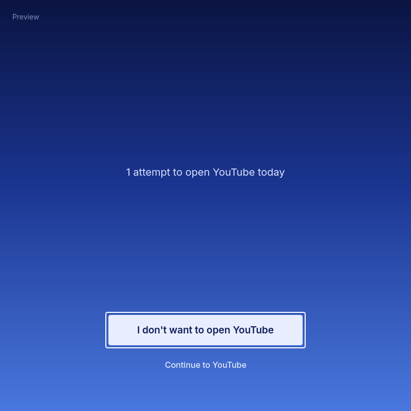

# OneSec



A breathing pause in front of the apps you pick, for
[Omarchy](https://omarchy.org). Inspired by [one sec](https://one-sec.app),
which does this on phones.

Turn it on with Super + ` when you want to stop yourself drifting into
something. Picked apps that are already open are hidden at once, and any you
open later stay hidden while a navy sheet rises for ten seconds as you
breathe in and sinks for ten as you breathe out. Then you choose: don't open
it (or Esc), and its windows close, or go on, and they come back where they
were. Turn OneSec off and everything opens right away again.

Nothing runs in the background. A few lines in Hyprland's config hold the
window back, and the pause is a small Qt program that only exists while it's
on screen.

## Install

```sh
bin/install
```

Then add these lines to `~/.config/hypr/hyprland.lua`, the first to load the
hook and the second for the on/off key:

```lua
pcall(dofile, "/usr/share/onesec/onesec.lua")
hl.bind("SUPER + GRAVE", hl.dsp.exec_cmd("onesec toggle"))
```

For the bar widget (an hourglass, an outline while OneSec is off and solid
while it's on; click to turn it on or off, right-click for the settings):

```sh
ln -s /usr/share/onesec/plugin ~/.config/omarchy/plugins/tom.onesec
omarchy bar put tom.onesec --after omarchy.tray
```

Open OneSec from the app launcher (Super + Space) to pick your apps.

## Websites

OneSec pauses websites too, through an extension for Brave or Chromium. Add
the websites in OneSec's settings, or with `onesec site add youtube.com`; each
covers its subdomains. Then turn the extension on and restart the browser:

```sh
onesec-browser-setup        # --remove undoes it
```

While OneSec is on, a tab heading to one of those websites waits on a blank
page while the same full-screen pause runs. Going on loads the page; not
going on closes the tab. Turning OneSec on also pauses the tabs already open
on them, behind one pause for all. The extension talks to a small helper
(`/usr/lib/onesec/onesec-host`), which reads OneSec's settings and runs the
pause. If the helper is missing, nothing is held.

## Commands

| Command | What it does |
| --- | --- |
| `onesec` | The settings: on or off, apps, the words on screen, breaths, and how long after going on you won't be paused again |
| `onesec toggle [on\|off]` | Turn OneSec on or off, with a notification |
| `onesec status` | Print `on` or `off` |
| `onesec site [list \| add <site>... \| remove <site>...]` | The websites the extension pauses |
| `onesec preview` | Show the pause as it will look |
| `onesec pause [--open] [--site] <target>...` | The pause itself; the Hyprland hook and the browser helper start it |

## Shortcuts

| Where | Key | What it does |
| --- | --- | --- |
| Anywhere | Super + ` | Turn OneSec on or off |
| Pause | Enter / Space | Press the focused choice |
| Pause | Tab / Up / Down | Move between the two choices |
| Pause | Esc | Don't open the app (or close it, if it was open), even mid-breath |
| Settings | ? | Show every shortcut |
| Settings | Ctrl + O | Turn OneSec on or off |
| Settings | Ctrl + F | Search apps |
| Settings | Space / Enter | Pick or unpick the app |
| Settings | Ctrl + T | Try the pause |
| Settings | Q | Quit |

## How it works

`hypr/onesec.lua` keeps a window rule that, while OneSec is on, sends new
windows of your picked apps to a hidden workspace (`special:onesec`) from
their first frame. Turning OneSec on also moves the picked apps' open windows
there, behind one pause for all of them. When one lands there, the hook runs `onesec pause`, which
covers the screen with a layer-shell overlay above the bar. Your choice calls
back into the hook through `hyprctl`. Turning OneSec off brings back any
window still waiting, so a crashed pause never strands one.

The app writes its settings to `~/.config/onesec/config.json` and a Lua copy
for the hook to `~/.local/state/onesec/hypr.lua`.

## Development

```sh
bin/build    # build/onesec
bin/test     # the backend tests, offscreen
```

The Omarchy shell keeps a plugin file it has loaded, even after
`omarchy-shell shell rescanPlugins`, so an edit to `plugin/OneSecBar.qml`
shows up only after `omarchy restart shell`.

`ONESEC_GRAB="a.png@1500,b.png@11800" QT_QPA_PLATFORM=offscreen build/onesec preview`
saves the pause at those moments without showing anything.
